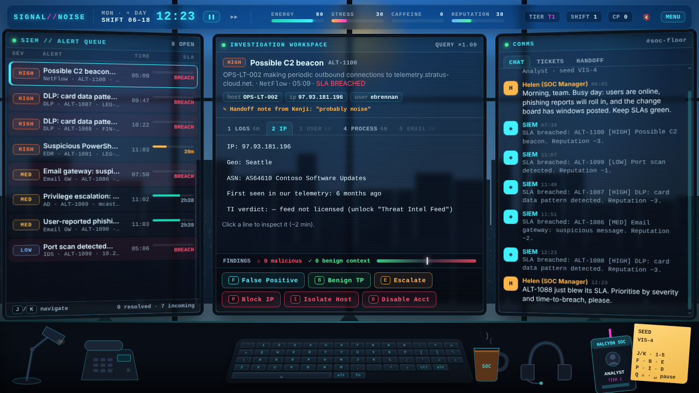
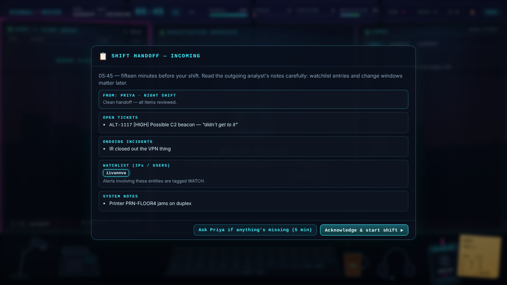

# SIGNAL//NOISE — A SOC Analyst Roguelike

> Survive the queue. Protect the org. Don't burn out.

**SIGNAL//NOISE** is a browser roguelike where you play a Security Operations Center (SOC) analyst at a 24/7/365 SOC. Each run is a career. Triage alerts, investigate logs, write shift handoffs, and climb from **Tier 1 Analyst** to **SOC Lead** before stress, a ruined reputation, or a catastrophic breach ends it all.

The whole game is **one self-contained HTML file**: no libraries, no build step, no network requests. It runs fully offline.

---

## ▶ Play

- **Locally:** download `index.html` and double-click it. It works in any modern desktop browser (Chrome, Firefox, Edge).
- **Online:** if GitHub Pages is enabled for this repo, play at
  `https://<your-username>.github.io/<repo-name>/`

Best at 1280×720 or larger.

---

## 🎮 How it plays

You sit at a first-person desk with three curved monitors:

| Monitor | What it does |
|---|---|
| **1 — SIEM Queue** | Incoming alerts with severity, source, timestamp and a live SLA countdown |
| **2 — Investigation** | Logs, IP lookup, user lookup, process trees, email headers |
| **3 — Comms** | Team chat, tickets, handoff notes, and the incident bridge during major incidents |

Behind the monitors, a city window tracks the shift clock, from sunrise through daylight to a neon skyline at night.

### The core loop
1. **Triage** an alert (free).
2. **Investigate**: run queries and inspect lines. Each costs in-game time and energy. Red lines are malicious indicators; green lines are benign context such as an approved change.
3. **Decide**: close it as a False Positive or Benign True Positive, escalate to Tier 2/IR, or contain it yourself (block IP, isolate host, disable account). Containment has to match the threat.
4. **Live with it.** Feedback arrives later, like the real job. True positives you miss come back on later shifts as worse incidents: a missed beacon on Tuesday night becomes ransomware on Thursday.

### Shifts & handoffs
- **Day (06:00–18:00):** more users, phishing reports, meetings, manager walk-bys.
- **Night (18:00–06:00):** skeleton crew, automated attacks, heavier fatigue. Coffee hits harder and crashes harder.
- **Incoming handoff (05:45 / 17:45):** read the outgoing analyst's notes. Some are sloppy and leave things out, and asking a follow-up question can surface what they forgot.
- **Outgoing handoff:** choose which open tickets, IOCs and warnings to pass on. You get a grade from A to F, and omissions come back as *"you didn't tell us about this."*

### Resources
- **Energy** drains over the shift. Coffee and breaks restore it.
- **Caffeine** boosts energy now, raises stress, and causes a crash later.
- **Stress** rises with backlog, mistakes and night shifts.
- **Reputation** rises with accurate calls and good handoffs.

### Major incidents
Every 5th shift, a major incident (ransomware outbreak, supply-chain compromise, or zero-day exploitation) opens a **timed incident bridge**. Complete at least 3 of 4 objectives before time runs out.

### Run endings
| Ending | Cause |
|---|---|
| 🔥 **Burnout** | Stress hits 100 |
| 📉 **Terminated** | Reputation hits 0 |
| 💥 **Catastrophic Breach** | A critical incident is missed, left open too long, dropped from a handoff, or a bridge fails |
| 👑 **Retired a Legend** | Reach SOC Lead and retire on your own terms |

### Progression
- **Within a run:** on days off, spend Career Points on rest, training and (fictional) certifications. Promotions need shifts survived, reputation, and the right cert.
- **Across runs:** earn Legacy Points to unlock permanent perks and tools: *Grep Ninja*, *Barista-Grade Coffee*, *Tuned Detection Rules*, *Mentor on Call*, *Threat Intel Feed*, *SOAR Playbooks*, and higher starting tiers.

---

## ⌨ Controls

| Key | Action |
|---|---|
| `J` / `K` | Move through the alert queue |
| `1`–`5` | Evidence tabs (Logs, IP, User, Process, Email) |
| `F` | Close as False Positive |
| `B` | Close as Benign True Positive |
| `E` | Escalate to Tier 2 / IR |
| `P` / `I` / `D` | Contain: Block IP / Isolate Host / Disable Account |
| `Q` / `R` | Sip coffee / refill mug |
| `Space` | Pause |
| `T` | Fast-forward ×3 |
| `M` | Toggle sound |
| `L` | Desk lamp |
| `Esc` | Menu |

Everything is also playable with the mouse.

---

## 🎲 Seeds

Every run uses a seeded RNG. The seed appears on the sticky note on your desk and in the run summary. Share it, and anyone entering the same seed gets the same career: the same alerts, handoffs and events.

---

## ⚙ Settings

- Clock speed (1–3 in-game minutes per real second)
- Sound effects, synthesized with the Web Audio API and **muted by default**
- Reduced motion
- CRT scanlines on/off
- Larger text

Progress is saved in `localStorage`. If storage is unavailable (e.g., some private-browsing modes), the game still runs without saving.

---

## 🛠 Tech

- One HTML file with inline CSS and JavaScript
- Visuals built from CSS, inline SVG and `<canvas>`. No images or fonts are loaded
- Audio generated with the Web Audio API
- No dependencies, no build step, no network requests

### Code layout (inside `index.html`)
The script is organized into numbered, commented sections:

1. Utilities & seeded RNG
2. Persistence (`localStorage`, wrapped in try/catch)
3. Static game data (tiers, certs, unlocks, achievements)
4. Organisation & evidence helpers
5. Alert generators (phishing, password spray, impossible travel, C2 beacon, PowerShell, exfil, privesc, insider, DDoS, scanner noise, false positives)
6–12. Game state, shift generation, simulation tick, decisions, resources, handoffs, run end
13. Random desk events
14. Boss encounters (incident bridge)
15. Tutorial
16. Audio
17–20. Rendering, screens, input and the main loop

### Tuning
To make the game easier or harder, start with these:
- `judge()`: reputation and points for each decision
- `SLA_BASE`: SLA minutes per severity
- `resources()`: energy drain and stress accumulation
- `TYPE_W`: the mix of alert types on day vs. night shifts

---

## ⚠ Disclaimer

All companies, people, domains, IP addresses and certifications are fictional. Any resemblance to real organizations is coincidental. The game is meant to be fun and loosely educational about SOC work. It is not a training course.
